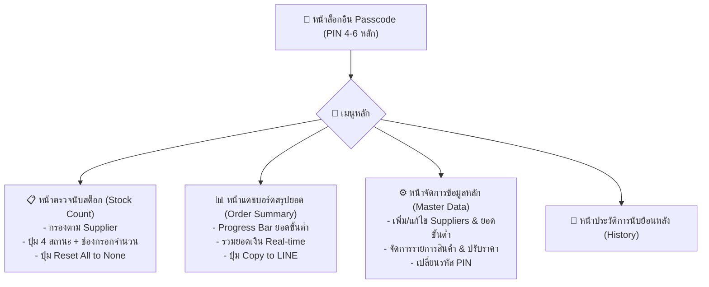

# เอกสารข้อกำหนดความต้องการของระบบ (Software Requirements Specification - SRS)
## โครงการ: ระบบตรวจนับสต็อกและคำนวณยอดสั่งซื้อขั้นต่ำ (Stock Checker & Supplier Order System)

---

### 1. บทนำและภาพรวมของระบบ (Introduction & Overview)
ระบบนี้ได้รับการออกแบบเพื่อช่วยให้เจ้าของร้านค้าสามารถเดินตรวจนับสต็อกสินค้าประจำสัปดาห์ผ่านสมาร์ทโฟนได้อย่างรวดเร็ว พร้อมทั้งประเมินและรวบรวมยอดสั่งซื้อสินค้าที่หมดสต็อก ($Out\ of\ Stock$) แยกตามรายบริษัทคู่ค้า (Suppliers) และเปรียบเทียบกับยอดสั่งซื้อขั้นต่ำ (Minimum Order Amount) แบบ Real-time เพื่อป้องกันการสั่งซื้อไม่ถึงเกณฑ์ และสามารถส่งสรุปออเดอร์ไปยังเซลส์ผ่าน LINE ได้ทันที

---

### 2. สถาปัตยกรรมและเทคโนโลยีที่เลือกใช้ (Architecture & Tech Stack)
* **Frontend & Backend:** Next.js (App Router, React, Tailwind CSS)
* **Database & ORM:** SQLite ข้อมูลบันทึกเป็นไฟล์ฐานข้อมูลในตัว ซิงค์ข้อมูลระหว่างอุปกรณ์มือถือและคอมพิวเตอร์ผ่านเครือข่าย/เซิร์ฟเวอร์เดียวกันได้ทันที
* **UI/UX Framework:** Mobile-First Design รองรับ Touch gestures, ปุ่มกดขนาดใหญ่ออกแบบสำหรับนิ้วมือ (Finger-friendly), มีแป้นตัวเลข (Numeric Keypad) สำหรับกรอก PIN และจำนวนสินค้า
* **Deployment Target:** Cross-platform web application รันผ่านเบราว์เซอร์ได้ทุกอุปกรณ์ (iOS Safari, Android Chrome, Desktop Browser)

---

### 3. ข้อกำหนดเชิงฟังก์ชัน (Functional Requirements)

#### 3.1 ระบบความปลอดภัยและการยืนยันตัวตน (Authentication & Access Control)
1. **Passcode Protection (PIN 4-6 หลัก):**
   * ล็อกอินก่อนเข้าใช้งานระบบด้วยรหัส PIN ตัวเลข 4-6 หลัก
   * มี Numeric Keypad บนหน้าจอเพื่อความสะดวกในการแตะกดผ่านมือถือ
   * บันทึกสถานะการเข้าสู่ระบบไว้ในอุปกรณ์ (Persistent Session / Cookie) เพื่อไม่ต้องกรอกซ้ำทุกครั้งที่เปิดเบราว์เซอร์
2. **การตั้งค่ารหัสผ่าน (PIN Management):**
   * เจ้าของร้านสามารถเปลี่ยนรหัส PIN ได้ผ่านหน้าจอตั้งค่า (Settings)

#### 3.2 ระบบจัดการข้อมูลหลัก (Master Data Management)
1. **การจัดการบริษัทคู่ค้า (Suppliers / Vendors):**
   * เพิ่ม, แก้ไข, ลบข้อมูลคู่ค้า (ชื่อบริษัท, เบอร์ติดต่อ, หมายเหตุ)
   * กำหนด **"ยอดสั่งซื้อขั้นต่ำ (Minimum Order Amount)"** แยกอิสระตามแต่ละบริษัท
2. **การจัดการรายการสินค้า (Items Catalog):**
   * เพิ่ม, แก้ไข, ลบรายการสินค้า (ชื่อสินค้า, หน่วยนับ, บริษัทคู่ค้าที่ผูกไว้)
   * แก้ไขราคาต่อหน่วย (Unit Price) ได้ตลอดเวลา เพื่อรองรับราคาสินค้าที่ผันแปรในแต่ละสัปดาห์
   * ช่องบันทึกหมายเหตุเฉพาะรายการ (Item Note)
3. **การค้นหาและกรองข้อมูล (Filter & Search):**
   * กรองดูสินค้าแยกตามบริษัทคู่ค้า (Filter by Supplier)
   * ช่องค้นหาด่วน (Search Bar) สำหรับค้นหาชื่อสินค้าขณะเดินนับสต็อก

#### 3.3 ระบบตรวจนับสต็อก (Stock Check Workflow)
1. **ปุ่มเลือกสถานะ 4 รูปแบบ (4-State Toggles):**
   * `None`: สถานะเริ่มต้น (ยังไม่ได้นับ) แสดงผลโทนสีกลาง
   * `In Stock`: สินค้ามีเพียงพอ $\rightarrow$ แสดงช่องกรอกจำนวนคงเหลือ (Remain)
   * `Low Stock`: สินค้าใกล้หมด $\rightarrow$ แสดงช่องกรอกจำนวนคงเหลือ (Remain)
   * `Out of Stock`: สินค้าหมดและต้องการสั่งซื้อ $\rightarrow$ บังคับกรอกจำนวนที่ต้องสั่งซื้อ (Ordered Quantity)
2. **Dynamic Input Form & Real-time Calculation:**
   * สลับช่องรับข้อมูลอัตโนมัติตามสถานะที่เลือก
   * คำนวณมูลค่าต่อรายการทันที:
     $$\text{Line Total} = \text{Price} \times \text{Count}$$
3. **ระบบรีเซ็ตประจำสัปดาห์ (Weekly Reset & Snapshot):**
   * ปุ่ม **"Reset All to None"** พร้อมกล่องยืนยันป้องกันการกดผิดพลาด
   * ระบบทำการ **บันทึกประวัติการนับ/สั่งซื้อของรอบสัปดาห์นั้น (Snapshot Archive)** เก็บลงฐานข้อมูลประวัติโดยอัตโนมัติก่อนล้างค่า
   * ล้างสถานะสินค้าทั้งหมดกลับเป็น `None` และเคลียร์จำนวน เพื่อเตรียมตรวจนับรอบถัดไป
   * มีหน้าดูประวัติย้อนหลัง (History Log)

#### 3.4 แดชบอร์ดสรุปยอดสั่งซื้อแบบ Real-time (Order & Minimum Dashboard)
1. **การรวมยอดเงินสั่งซื้อตามคู่ค้า (Group by Supplier):**
   * คัดเฉพาะรายการที่มีสถานะ `Out of Stock` มารวมยอดเงินที่จะต้องสั่งซื้อแยกตามรายบริษัท:
     $$\text{Total Order Amount} = \sum (\text{Unit Price} \times \text{Ordered Quantity})$$
2. **Real-time Minimum Progress Indicator:**
   * แถบ Progress Bar แสดงสัดส่วนยอดสั่งซื้อปัจจุบันเทียบกับยอดสั่งซื้อขั้นต่ำ
   * แสดงตัวเลขส่วนต่างอัตโนมัติ เช่น *“ยอดสั่ง 3,450 / ขั้นต่ำ 5,000 บาท (ขาดอีก 1,550 บาท)”*
   * สถานะสีแบบไดนามิก:
     * **สีเขียว (Success):** เมื่อยอดสั่งซื้อถึงหรือเกินขั้นต่ำ
     * **สีส้ม/แดง (Warning):** เมื่อยอดสั่งซื้อยังไม่ถึงเกณฑ์ขั้นต่ำ
3. **การส่งต่อออเดอร์ (Export to LINE):**
   * ปุ่ม **"Copy to LINE"** แยกตามบริษัทคู่ค้า
   * รูปแบบข้อความจัดฟอร์แมตพร้อมส่งทันที เช่น:
     ```text
     📦 รายการสั่งซื้อ - บริษัท A
     ------------------------
     1. น้ำดื่ม 600ml x 10 แพ็ค = 500 บาท
     2. ข้าวสารหอมมะลิ x 5 ถุง = 1,100 บาท
     ------------------------
     ยอดรวมทั้งหมด: 1,600 บาท
     (ถึงยอดสั่งซื้อขั้นต่ำ 1,500 บาท แล้ว)
     ```

---

### 4. ผังหน้าจอการใช้งาน (User Flow & Screen Layout)


---

### 5. ข้อกำหนดด้านการออกแบบ UI/UX (Design Principles)
* **Finger-Friendly Targets:** ปุ่มกดสเตตัส (None, In Stock, Low Stock, Out of Stock) และปุ่มบันทึกมีขนาดความสูงขั้นต่ำ $48\text{px}$ เพื่อให้กดได้แม่นยำด้วยนิ้วมือเดียวขณะเดินตรวจสินค้า
* **High Contrast & Clarity:** ตัวเลขราคาและผลรวมอ่านง่าย ตัวหนังสือไม่เล็กเกินไป มีการใช้ Badge สีชัดเจน (เขียว, เหลือง, แดง, เทา)
* **Immediate Feedback:** ไม่ต้องโหลดหน้าใหม่เมื่อเปลี่ยนสถานะหรือกรอกตัวเลข ผลรวมบนแถบสรุปปรับตัวเลขอัตโนมัติทันที
